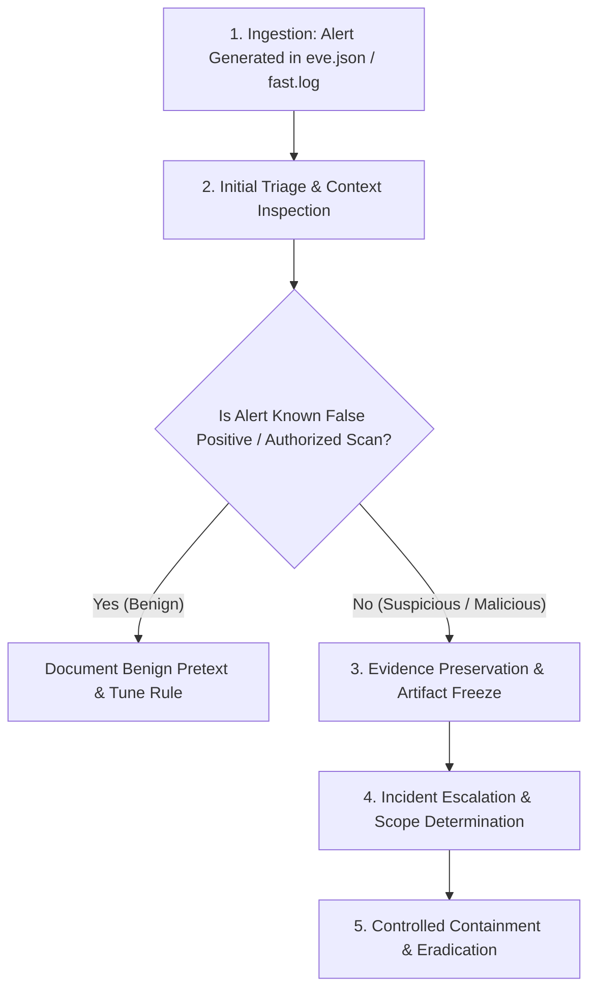

# SOC Incident Response Playbook: Network Intrusion Detection Alerts
**CodeAlpha Cyber Security Internship — Task 4: Network Intrusion Detection System**

---

## 1. Purpose & Guiding Principles

This playbook establishes a standard operating procedure for Security Operations Center (SOC) analysts and incident handlers triaging alerts produced by the **Suricata Network Intrusion Detection System (NIDS)**.

### Core Defensive Tenets:
1. **Never Take Unilateral Destructive Action:** Do not execute automated firewall blocks, disable network adapters, or disrupt critical production services without documented change approval and verification of scope.
2. **Preserve Digital Forensics First:** Volatile packet payloads, connection flow records, and raw PCAPs must be preserved prior to endpoint remediation.
3. **Verify Context Over Knee-Jerk Reaction:** Correlate IDS alerts with host-based telemetry (EDR/Sysmon), authentication logs, and threat intelligence before classifying an event as an active breach.

---

## 2. Standard 5-Phase Triage Workflow



---

## 3. Phase-by-Phase Operational Procedures

### Phase 1: Alert Detection & Notification
Alerts are ingested via Suricata's `logs/eve.json` and mirrored in `logs/fast.log`.
* **Dashboard View:** Monitor real-time metrics and severity distribution via `http://127.0.0.1:8080`.
* **CLI Notification:** Use the parsing script to stream recent alerts:
  ```powershell
  python scripts/parse_eve.py --severity High
  ```

---

### Phase 2: Contextual Triage & Analysis

When an alert is flagged, collect the fundamental 5-tuple context:
* **Timestamp (UTC / Local):** Determines attack sequencing and session duration.
* **Source IP and Port:** Identifies the initiating host (internal workstation, rogue device, or external entity).
* **Destination IP and Port:** Identifies the target service (web application, database, domain controller).
* **Protocol & Flags:** Evaluates transport layer anomalies (TCP SYN, FIN/PSH/URG, ICMP, DNS).
* **Signature Metadata:** Note the Signature ID (SID), severity level, and classtype.

#### Inspecting Raw Event Details:
Query the specific alert directly in `eve.json`:
```powershell
python scripts/parse_eve.py --sid 1000007 --json
```
Review the printable payload (`payload_printable`) to inspect the actual bytes transmitted.

---

### Phase 3: False Positive Determination

Before escalating, determine whether the traffic represents legitimate administrative or developmental activity:

| Evaluation Check | Potential False Positive Indicator | Malicious Indicator |
| :--- | :--- | :--- |
| **Source Host Identity** | Approved vulnerability scanner (e.g., Nessus/Qualys) on an authorized scanning window | Non-security employee laptop or unknown IP address |
| **User-Agent String** | Internal integration API client or testing script | Hacker tooling (e.g., `sqlmap`, `nikto`, `AlphaInfiltrationScanner`) |
| **Port Scan Velocity** | Scheduled network management tool mapping assets | Rapid horizontal or vertical probe with zero payload |
| **Web Shell String** | Web development QA test case or code documentation search | Unauthenticated `POST` request to an upload directory containing `cmd=` or `eval()` |

---

### Phase 4: Forensic Evidence Preservation

Preserve the digital chain of custody immediately upon validating suspicious traffic:
1. **Copy the Active EVE Log:**
   ```powershell
   Copy-Item "logs\eve.json" "evidence\eve_incident_$(Get-Date -Format 'yyyyMMdd_HHmmss').json"
   ```
2. **Preserve the Full PCAP Stream:**
   Archive the associated network capture file with SHA256 checksums:
   ```powershell
   Get-FileHash "data\lab_traffic.pcap" -Algorithm SHA256 | Out-File "evidence\pcap_hash.txt"
   ```
3. **Capture Host Process Table:**
   If the source IP is an internal workstation, record active processes and open sockets on the endpoint before rebooting:
   ```powershell
   Get-Process | Select-Object Id, ProcessName, Path | Out-File "evidence\host_processes.txt"
   Get-NetTCPConnection | Where-Object { $_.State -eq 'Established' } | Out-File "evidence\active_connections.txt"
   ```

---

### Phase 5: Escalation & Containment Protocol

#### Severity Escalation Matrix:
* **Priority 3 (Low / Informational):** Logged for trend analysis. Review during daily SOC standup. No immediate escalation unless combined with higher-priority alerts.
* **Priority 2 (Medium - Reconnaissance / Scan):** Investigate source within 2 hours. If source is internal, check endpoint for malware compromise.
* **Priority 1 (High - Web Shell / Exploit Attempt):** Immediate 15-minute SLA escalation to Incident Commander / Senior Security Analyst.

#### Controlled Containment Actions (Require Explicit Operator Authorization):
1. **Endpoint Network Isolation:** If an internal endpoint is verified compromised, disconnect the workstation from VLAN or trigger EDR network isolation (halt lateral movement while preserving memory).
2. **Targeted Firewall Ingress Block:** Coordinate with Network Engineering to blackhole or drop the rogue IP address at the perimeter firewall.
3. **Session Revocation & Credential Reset:** Revoke all active session cookies and rotate passwords if credentials were intercepted in transit.
4. **Web Root Audit:** If a web shell alert (e.g. SID 1000007) fired, inspect the destination web directory for newly written or disguised PHP/ASP files.
